# ⚡ Painel do Setor Elétrico Brasileiro & Data Lakehouse ANEEL

[](https://www.python.org/)
[](https://fastapi.tiangolo.com/)
[](https://www.typescriptlang.org/)
[](https://react.dev/)
[](https://vitejs.dev/)
[](https://cloud.google.com/)
[](https://airflow.apache.org/)
[](https://cloud.google.com/dataform)
[](https://tailwindcss.com/)
[](LICENSE)

> **Plataforma Analítica e Executiva (C-Level & Especialistas Setoriais)** para monitoramento operacional, conformidade regulatória, perdas energéticas, satisfação do consumidor e simulação tarifária da cadeia de valor do Setor Elétrico Brasileiro.

---

## 📌 Sumário Executivo

O projeto integra dados de fontes oficiais do setor elétrico (**ANEEL, ONS e CCEE**) em um **Data Lakehouse corporativo no Google Cloud Platform (GCP)**, seguindo a arquitetura **Medallion (Bronze ➔ Silver ➔ Gold)** acelerada in-memory via **BigQuery BI Engine**. 

A aplicação entrega uma interface responsiva e moderna desenvolvida em **React 18 + TypeScript + Vite + TailwindCSS**, alimentada por uma API de alta performance em **FastAPI**.

---

## 🏛️ Arquitetura da Solução

```mermaid
flowchart TD
    subgraph FONTES["Fontes de Dados Abertos Oficiais"]
        A1["ANEEL (PRODIST, SISGD, PRORET, Ouvidoria, IASC)"]
        A2["ONS (EAR, ENA, CMO, Carga, Térmicas)"]
        A3["CCEE (PLD, GSF, ESS, Bandeiras Tarifárias)"]
    end

    subgraph LAKEHOUSE["Google Cloud Lakehouse (kpisetoreletrico)"]
        subgraph BRONZE["Camada Bronze (GCS)"]
            B1["gs://kpisetoreletrico-datalake-bronze/aneel/"]
            B2["Arquivos Brutos (Parquet & CSV Oficiais)"]
        end
        subgraph SILVER["Camada Silver (BigQuery)"]
            S1["Dataset: aneel_silver"]
            S2["dec_fec_distribuidoras (Particionado)"]
            S3["mmgd_instalacoes (27 UFs)"]
            S4["tarifas_homologadas (103 Concessionárias)"]
            S5["ouvidoria_reclamacoes (Nível 2 & IASC)"]
        end
        subgraph GOLD["Camada Gold (BigQuery + BI Engine)"]
            G1["Dataset: gold_kpis (In-Memory Acceleration)"]
            G2["kpi_dec_fec_conformidade"]
            G3["kpi_mmgd_expansao_uf"]
            G4["kpi_tarifas_ranking"]
            G5["kpi_ouvidoria_satisfacao"]
        end
    end

    subgraph BACKEND["Backend REST API (FastAPI)"]
        API["FastAPI 0.115 (Python 3.11 / 3.13)"]
        SIM["Simulador PRORET (Fórmula de Revisão Tarifária)"]
        MON["Monitoramento Lakehouse (/datalake/status)"]
    end

    subgraph FRONTEND["Frontend SPA (React 18 / Vite)"]
        UI1["Visão Executiva & Mapa do SIN"]
        UI2["Qualidade PRODIST (DEC/FEC)"]
        UI3["Perdas & MMGD Solar (27 UFs)"]
        UI4["Ranking Tarifário PRORET (103 Distribuidoras)"]
        UI5["Atendimento Comercial & IASC"]
    end

    FONTES -->|"Ingestores Python / Airflow"| BRONZE
    BRONZE -->|"MERGE / Validação de Tipos"| SILVER
    SILVER -->|"Dataform SQLX / Assertions"| GOLD
    GOLD -->|"Consultas Sub-segundo"| BACKEND
    BACKEND -->|"JSON REST API + Metadados"| FRONTEND
```



---

## 🎯 Domínios de Negócio & Funcionalidades

### 1. 🌐 Visão Executiva & Matriz de Síntese
- **C-Level Owner Tracking:** Monitoramento categorizado por responsabilidade regulatória e operacional (CEO, COO, CFO).
- **Mapa Interativo do SIN:** Visualização vetorial com inspeção dinâmica dos 4 subsistemas (Sudeste/Centro-Oeste, Sul, Nordeste e Norte).
- **Centro de Alertas:** Badges em tempo real para limites estourados de DEC/FEC, risco de descolamento de GSF e perdas não-técnicas.

### 2. ⚡ Qualidade da Distribuição (Módulo 8 do PRODIST)
- **Indicadores Coletivos DEC e FEC:** Apurado vs Metas homologadas pela ANEEL.
- **Compensações Financeiras:** Estimativa de ressarcimento aos consumidores por violação de continuidade.
- **Conformidade de Tensão:** DRP (Duração Relativa da Transgressão de Tensão Precária) e DRC (Crítica).

### 3. ☀️ Perdas Energéticas & Expansão MMGD (Lei 14.300)
- **Balanço Energético Nacional:** Segregação entre Perdas Técnicas (física da rede) e Perdas Não-Técnicas (comerciais/furtos/fraudes).
- **Penetração da Geração Distribuída:** Ranking oficial das **27 UFs** com potência instalada (MW) e quantidade de Unidades Consumidoras com autogeração solar.
- **Inadimplência e PDD:** Provisão para devedores duvidosos por concessionária.

### 4. 💰 Econômico-Financeiro & Motor Regulatório PRORET
- **Ranking Tarifário ANEEL (103 Distribuidoras Homologadas):**
  - Tarifas de aplicação para **B1 Residencial (R$/kWh)**, **B3 Comercial (R$/kWh)** e **A4 Média Tensão / Industrial (Demanda Verde R$/kW + Fora Ponta R$/MWh)**.
  - Decomposição visual dos custos regulatórios: Parcela B / Fio (**TUSD %**) vs Parcela A / Energia (**TE %**).
  - Consulta direta a Resoluções Homologatórias e datas de vigência.
- **Simulador Interativo de Revisão Tarifária PRORET:**
  $$\text{Receita Requerida} = [\text{BRR Líquida} \times \text{WACC}] + \text{OPEX Eficiente} - \text{Fator X} \pm \text{Componente Q}$$
- **Painel Corporativo DRE:** Receita Líquida, EBITDA, Margem, Lucro Líquido, CAPEX e Alavancagem Financeira (Dívida Líquida / EBITDA).

### 5. 🎧 Atendimento Comercial, IASC & Ouvidoria
- **Ranking Oficial IASC:** Índice ANEEL de Satisfação do Consumidor com classificação e scores auditados.
- **Ouvidoria ANEEL (Nível 2):** Volume de manifestações escaladas para a agência reguladora, taxa de procedência e tempo médio de resolução em dias.
- **Níveis de Serviço em Call Center:** Indicador de Nível de Serviço (INS > 85%) e Índice de Abandono (IAb < 5%).

---

## 📂 Estrutura do Repositório

```text
kpis-setor-eletrico/
├── backend/                        # API REST em FastAPI
│   ├── app/
│   │   ├── api/                    # Rotas e controladores REST
│   │   │   ├── routes_distribuicao.py
│   │   │   ├── routes_perdas_mmgd.py
│   │   │   ├── routes_financeiro_proret.py
│   │   │   ├── routes_atendimento.py
│   │   │   ├── routes_ingestion.py # Monitoramento do Lakehouse
│   │   │   └── ...
│   │   ├── core/                   # Clientes BigQuery, simuladores e configs
│   │   │   ├── bigquery_client.py  # Conexão Gold/Silver com fallback resiliente
│   │   │   └── simulator.py        # Motor de cálculo PRORET
│   │   └── main.py                 # Ponto de entrada FastAPI
│   ├── requirements.txt            # Dependências Python
│   └── run.py                      # Script de execução Uvicorn
│
├── frontend/                       # SPA React 18 + TypeScript + Vite
│   ├── src/
│   │   ├── components/             # Componentes modulares (StatCards, Headers, etc.)
│   │   ├── pages/                  # Telas temáticas do setor elétrico
│   │   │   ├── DistributionQuality.tsx # Qualidade DEC/FEC PRODIST
│   │   │   ├── LossesMmgd.tsx          # Perdas & 27 UFs MMGD
│   │   │   ├── FinancialProret.tsx     # 103 Tarifas Homologadas & Simulador
│   │   │   ├── CustomerService.tsx     # IASC & Ouvidoria ANEEL
│   │   │   └── ExecutiveSummary.tsx    # C-Level & Mapa do Brasil
│   │   └── services/api.ts         # Integração HTTP com a API
│   ├── package.json
│   └── vite.config.ts
│
├── pipelines/                      # Engenharia de Dados & Data Lakehouse
│   ├── infrastructure/             # Scripts de criação GCS, BI Engine e Composer
│   ├── ingestion/                  # Extratores de APIs e Dados Abertos ANEEL
│   ├── airflow/dags/               # Orquestração de DAGs periódicas
│   └── dataform/                   # Modelagem SQLX Silver -> Gold
│
├── Dockerfile                      # Build multi-stage para Cloud Run
├── start.sh                        # Script de inicialização unificada
├── .env.example                    # Template de variáveis de ambiente
├── .gitignore                      # Regras de exclusão de artefatos
├── LICENSE                         # Licença MIT
└── README.md                       # Documentação principal
```

---

## 🚀 Como Executar Localmente

### Pré-requisitos
- **Python 3.11+** (recomendado 3.12 ou 3.13)
- **Node.js 18+** ou **22+** e **npm**
- (Opcional) **Google Cloud SDK (`gcloud`)** configurado caso queira consultar o BigQuery em produção.

### 1. Clonar o Repositório
```bash
git clone https://github.com/meneghimfabio/kpis-setor-eletrico.git
cd kpis-setor-eletrico
```

### 2. Configurar Variáveis de Ambiente
```bash
cp .env.example .env
```

### 3. Inicialização Automática (Frontend + Backend)
Execute o script utilitário na raiz do projeto:
```bash
chmod +x start.sh
./start.sh
```

---

### Inicialização Manual (Passo a Passo)

#### Backend (FastAPI)
```bash
cd backend
python3 -m venv venv
source venv/bin/activate  # No Windows: venv\Scripts\activate
pip install -r requirements.txt
python run.py
```
- A API estará ativa em: `http://localhost:8000`
- Documentação interativa Swagger: `http://localhost:8000/api/v1/docs`

#### Frontend (React / Vite)
```bash
cd frontend
npm install
npm run dev
```
- O painel web estará disponível em: `http://localhost:5173`

---

## 🌊 Execução das Pipelines do Data Lakehouse

Para rodar a ingestão e atualização das 3 camadas da ANEEL:

```bash
# 1. Ingestão da Camada Bronze (GCS) e Carga na Camada Silver (BigQuery):
PYTHONPATH=. ./backend/venv/bin/python pipelines/ingestion/aneel_tarifas_ingestor.py
PYTHONPATH=. ./backend/venv/bin/python pipelines/ingestion/aneel_prodist_ingestor.py
PYTHONPATH=. ./backend/venv/bin/python pipelines/ingestion/aneel_mmgd_ingestor.py
PYTHONPATH=. ./backend/venv/bin/python pipelines/ingestion/aneel_ouvidoria_ingestor.py

# 2. Transformação da Camada Silver para a Camada Gold:
PYTHONPATH=. ./backend/venv/bin/python pipelines/dataform/run_transformations.py
```

---

## 🐳 Execução via Docker

A aplicação conta com um build multi-stage otimizado:
```bash
# Build da imagem unificada
docker build -t kpis-setor-eletrico:latest .

# Execução do container
docker run -p 8080:8080 \
  -e GCP_PROJECT_ID=kpisetoreletrico \
  kpis-setor-eletrico:latest
```
Acesse `http://localhost:8080`.

---

## ☁️ Deploy no Google Cloud Platform

Consulte o [DEPLOYMENT.md](DEPLOYMENT.md) para detalhes de implantação no **Cloud Run**, **Cloud Composer 3** e configuração do **BigQuery BI Engine**.

```bash
# Deploy com um único comando no Google Cloud Run:
gcloud run deploy kpis-setor-eletrico \
  --source . \
  --region us-central1 \
  --allow-unauthenticated \
  --set-env-vars GCP_PROJECT_ID=kpisetoreletrico,PORT=8080
```

---

## 📤 Instruções para Subir ao GitHub

Para publicar este projeto em sua conta GitHub (`https://github.com/meneghimfabio`):

```bash
# 1. Na raiz do projeto, inicialize o repositório git:
git init

# 2. Adicione todos os arquivos respeitando o .gitignore:
git add .

# 3. Crie o primeiro commit:
git commit -m "feat: initial commit - Painel e Data Lakehouse Medallion do Setor Eletrico"

# 4. Defina a branch principal como main:
git branch -M main

# 5. Adicione o repositório remoto (crie o repo 'kpis-setor-eletrico' no GitHub previamente):
git remote add origin https://github.com/meneghimfabio/kpis-setor-eletrico.git

# 6. Envie o código para o GitHub:
git push -u origin main
```

---

## 📄 Licença

Distribuído sob a licença **MIT**. Consulte [LICENSE](LICENSE) para obter mais informações.

---

## 👤 Autor

**Fabio Meneghim**  
- GitHub: [@meneghimfabio](https://github.com/meneghimfabio)  
- Projeto: [KPIs do Setor Elétrico](https://github.com/meneghimfabio/kpis-setor-eletrico)
